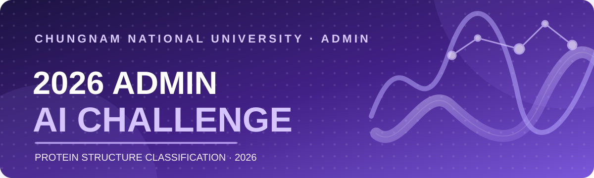

### 단백질의 구조를 읽고, AI로 가능성을 넓히다.

**2026 ADMIN AI Challenge**는 단백질 도메인의 서열과 3차원 구조를 활용하여
**CATH Architecture를 분류하는 AI 모델링 대회**입니다.

충남대학교 소프트웨어중심대학사업단 · ADMIN

[대회 소개](#-대회-소개) · [참가팀의 기록](#-참가팀의-기록) · [프로젝트](#-프로젝트)

---

## 🧬 대회 소개

단백질을 구성하는 아미노산 서열과 제공된 3D 구조(Cα 좌표)를 바탕으로 구조적 특징을 학습하고, 각 단백질 도메인을 **20개 CATH Architecture 클래스 중 하나로 분류**하는 문제를 다뤘습니다.

| 항목 | 대회 내용 |
| :--- | :--- |
| 주제 | 단백질 구조 기반 CATH Architecture 다중 클래스 분류 |
| 데이터 | CATH v4.4 S40 기반 단백질 도메인 |
| 데이터 규모 | 학습 21,339개 · 평가 5,330개 (총 26,669개) |
| 분류 대상 | 20개 Architecture 클래스 |
| 평가 지표 | Macro F1 |
| 평가 방식 | Public 약 30% · Private 약 70% |
| 모델 제출 | 학습된 모델과 추론 코드를 ZIP으로 제출 |
| 최종 순위 | 팀별 Public 최고 점수 제출물의 Private 점수 |

> **서열에서 구조로, 데이터에서 발견으로.** 서로 다른 접근으로 단백질의 구조적 패턴을 학습하고 분류 성능을 개선하는 과정에 도전했습니다.

## 📊 참가팀의 기록

대회에 참여한 팀들이 각자의 접근 방식으로 만들어 낸 결과입니다. 아래는 제공된 최종 리더보드 화면에 표시된 **11개 팀의 기록**을 옮긴 것입니다.

| 표시 순위 | 팀 | 제출 | Public F1 | Private F1 |
| :---: | :--- | :---: | ---: | ---: |
| 1 | Team. 고고학과 | #149 | 0.6227 | 0.6331 |
| 2 | 멋진 깻잎 | #172 | 0.6396 | 0.5900 |
| 3 | 에이~아이에요~ | #159 | 0.6022 | 0.5600 |
| 4 | 해커톤인지도모르구여기에나wouldlikehatertoponeForthechuckwonder | #156 | 0.5823 | 0.5676 |
| 5 | 우리가이긴단백질 | #132 | 0.5809 | 0.5543 |
| 6 | 아랑해~ | #151 | 0.5694 | 0.5520 |
| 7 | 요들레이히~~~말고 엉크크 | #167 | 0.5639 | 0.5457 |
| 8 | 강준서헷어도괜찮아영? | #179 | 0.5532 | 0.5426 |
| 9 | 궁주민 | #155 | 0.5217 | 0.5304 |
| 10 | 26준비완료 | #114 | 0.4817 | 0.4597 |
| 11 | bAlo | #174 | 0.4903 | 0.4511 |

운영진(관리자) 팀은 제외했습니다. 점수는 Macro F1이며, 표의 표시 순위는 원본 캡처 그대로입니다. 단, 3위(Private 0.5600)와 4위(Private 0.5676)는 점수의 크기와 표시 순서가 일치하지 않아 운영 데이터 확인이 필요합니다. 이 표는 정적 기록이며 실시간 리더보드가 아닙니다.

## 🛠️ 프로젝트

대회에서 사용한 웹사이트·제출 관리·모델 평가 파이프라인은 아래 프로젝트에서 개발했습니다.

| 리소스 | 내용 |
| :--- | :--- |
| [대회 웹사이트 및 채점 시스템](https://github.com/2026-admin-ai-challenge/admin-2026-protein-structure-challenge) | 참가자 화면, 제출·채점 API, 운영 도구, 리더보드 |
| [참가자 안내](https://github.com/2026-admin-ai-challenge/admin-2026-protein-structure-challenge/blob/main/docs/competition.md) | 대회 참가 방식과 모델 제출 형식 |
| [평가 방식](https://github.com/2026-admin-ai-challenge/admin-2026-protein-structure-challenge/blob/main/docs/evaluation.md) | Macro F1, Public / Private 평가, 순위 산정 |

---

### Thank you, challengers! 💜

다양한 모델과 아이디어로 함께한 모든 참가팀에 감사드립니다.

**ADMIN AI Challenge · 2026**

